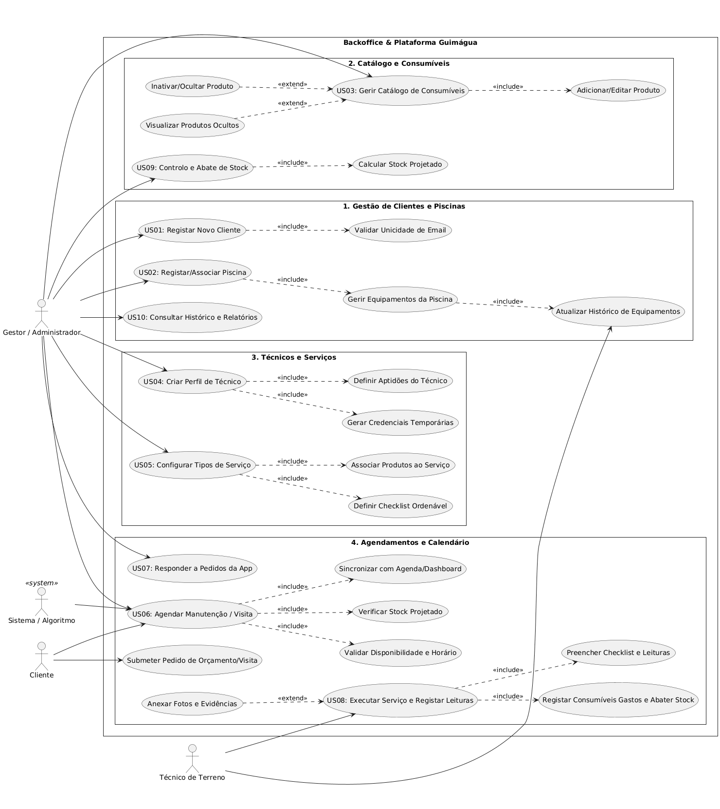

# Escrita das User Stories do MVP

| Campo | Valor |
|---|---|
| Card Trello | #14 — [abrir no Trello](https://trello.com/c/v1cJKjlX) |
| Lista / Sprint | 13.10.2026 Sprint 1 WEB |
| Etiquetas | Documentação |
| Responsáveis | Leandro Castro, David |
| Última atividade | 2026-11-21 |

## Descrição

### 1. Gestão de Clientes e Piscinas

**US01: Registo de Cliente**

Como gestor, quero registar um novo cliente no backoffice para manter a base de dados de contactos centralizada.

- **Critérios de Aceitação:**
  - O formulário deve solicitar Nome, Morada, Telefone e Email.
  - O sistema deve impedir a criação de dois clientes com o mesmo endereço de email.
  - Após guardar, o sistema deve apresentar uma notificação de sucesso e redirecionar para a ficha do cliente.

**US02: Ficha e Equipamentos da Piscina**

Como gestor, quero associar os detalhes técnicos de uma piscina ao perfil de um cliente para que a equipa saiba o que vai encontrar no terreno.

- **Critérios de Aceitação:**
  - Deve ser possível adicionar múltiplas piscinas a um único cliente.
  - O formulário deve incluir Dimensões, Volume de Água e a seleção de Equipamentos Instalados (ex: bomba, filtro, clorador).
  - Qualquer alteração aos equipamentos deve ficar registada no histórico. O histórico deve ter registo de data e estar sincronizado com as manutenções, para poderem ser feitas alterações pelos técnicos e automaticamente atualizarem a ficha de cliente.

### 2. Catálogo e Consumíveis

**US03: Gestão de Consumíveis e Materiais**

Como gestor, quero adicionar e editar produtos no catálogo de materiais para garantir que a tabela de preços está atualizada para os orçamentos.

- **Critérios de Aceitação:**
  - Deve ser possível inserir Nome do Produto, Categoria (Consumível ou Acessório), Unidade de Medida e Preço Unitário.
  - O sistema deve permitir inativar um produto (ocultando-o de novas consultas) sem o apagar do histórico. **ATENÇÃO:** Ao ser um produto oculto deve sempre haver maneira de ver os produtos ocultos para não causar soft delete acidentais, ou seja, tem de haver sempre acesso a isso pelo software.

### 3. Técnicos e Serviços

**US04: Gestão de Equipa Técnica**

Como gestor, quero criar perfis para os técnicos de manutenção para lhes poder atribuir rotas e serviços diários.

- **Critérios de Aceitação:**
  - O formulário deve recolher Nome, Contacto e Serviços que o funcionário está apto a realizar.
  - A criação do perfil deve gerar automaticamente credenciais de acesso temporárias para a aplicação móvel.

**US05: Configuração de Tipos de Serviço**

Como gestor, quero definir tipos de serviços padronizados e as respetivas _checklists_ para garantir que os técnicos não se esquecem de nenhum passo na obra.

- **Critérios de Aceitação:**
  - O sistema deve permitir criar um título (ex: "Tratamento Químico") e adicionar múltiplas tarefas à _checklist_.
  - Deve ser possível reordenar os itens da _checklist_ antes de guardar.
  - Deve ser possivel associar produtos ou tipos de produto a cada serviço, para os técnicos não se esquecerem de os levar ao prepararem se para o serviço, ainda na empresa, assim nao causa o "ah pois para esta manutencao preciso de certo produto, mas afinal nao temos em stock".

### 4. Agendamentos e Calendário

**US06: Marcação de Visitas**

Como gestor, quero agendar uma manutenção na piscina de um cliente e atribuí-la a um técnico para organizar os serviços do dia.

Cliente e/ou algoritmo também deverão conseguir fazer agendamentos.

- **Critérios de Aceitação:**
  - O gestor deve selecionar o Cliente/Piscina, o Tipo de Serviço e a Data/Hora pretendida.
  - O sistema deve validar e emitir um aviso caso o técnico selecionado já tenha um serviço sobreposto nesse horário.(deve notificar se os produtos necessarios para essa visita estao em stock, e levar em consideracao o que ainda vai ser gasto por visitas nos entretantos)
  - O agendamento gravado deve aparecer refletido de imediato na vista de Agenda/Dashboard.

**US07: Resposta a Pedidos da App** Como gestor, quero visualizar os pedidos de orçamento ou de visita submetidos pelos clientes na aplicação móvel para poder dar-lhes seguimento.

- **Critérios de Aceitação:**
  - A lista deve mostrar os pedidos pendentes ordenados por data mais antiga.
  - O gestor deve poder alterar o estado do pedido (ex: Pendente -> Em Análise -> Respondido).

---

**US08: Execução de Serviço e Registo de Leituras / Consumíveis**

Como técnico, quero aceder ao serviço atribuído, validar as tarefas da checklist, introduzir as leituras físico-químicas (pH, cloro, temperatura) e registar os consumíveis gastos, para dar a intervenção como concluída e gerar o relatório do cliente.

- **Critérios de Aceitação:**
  1. A checklist deve permitir marcar cada tarefa como concluída.
  2. O formulário deve exigir a inserção de valores válidos para pH, cloro e temperatura.
  3. Deve permitir selecionar os consumíveis utilizados e as respetivas quantidades gastas (atualizando o histórico e consumos).
  4. A submissão com sucesso altera o estado do agendamento para `"Concluído"` e atualiza os equipamentos da piscina se houver substituições (alimentando o critério da US02).

**US09: Controlo e Abate de Stock de Consumíveis**

Como gestor, quero registar as quantidades em stock e visualizar o inventário projetado de cada produto, para garantir que não são agendados serviços sem material disponível.

- **Critérios de Aceitação:**
  1. Cada produto no catálogo deve ter registo de quantidade disponível em armazém.
  2. O sistema deve calcular o stock projetado: $\text{Stock Projetado} = \text{Stock Físico} - \text{Qtd. Comprometida em Serviços Agendados}$.
  3. A finalização de uma intervenção pelo técnico deve abater automaticamente as unidades gastas no stock físico.

**US10: Gestão do Ciclo de Vida e Histórico de Intervenções no Backoffice**

Como gestor, quero consultar o histórico detalhado de intervenções e relatórios técnicos de uma piscina, para poder responder a dúvidas do cliente e acompanhar a atividade da equipa.

- **Critérios de Aceitação:**
  1. O perfil da piscina deve ter um separador com todo o histórico de manutenções realizadas.
  2. Deve ser possível visualizar as fotografias anexadas e os consumíveis debitados em cada visita.

## Anexos

- [app-piscinas-funcionalidades.md](app-piscinas-funcionalidades.md) — versão em texto de [app-piscinas-funcionalidades.pdf](app-piscinas-funcionalidades.pdf)

_user-stories-mvp.png — original: image.png_
