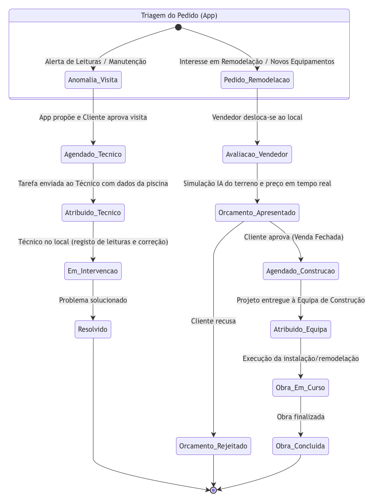
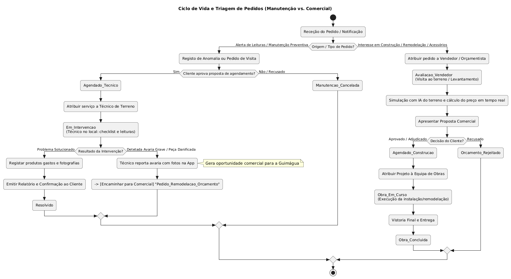

# Diagrama de Estados: Ciclo do Serviço

| Campo | Valor |
|---|---|
| Card Trello | #24 — [abrir no Trello](https://trello.com/c/5sRZReIj) |
| Lista / Sprint | 13.10.2026 Sprint 1 WEB |
| Etiquetas | Documentação |
| Responsáveis | Rui Filipe Rodrigues Sousa, Nelson Silva |
| Última atividade | 2026-11-05 |

## Descrição

Mapear os estados pelos quais um serviço passa (ex: Agendado -> Em Curso -> Concluído).

## Anexos

_diagrama-estados-servico-01.png — original: Diagrama_de_Estados_de_Serviços.drawio.png_

_diagrama-estados-servico-02.png — original: image.png_
