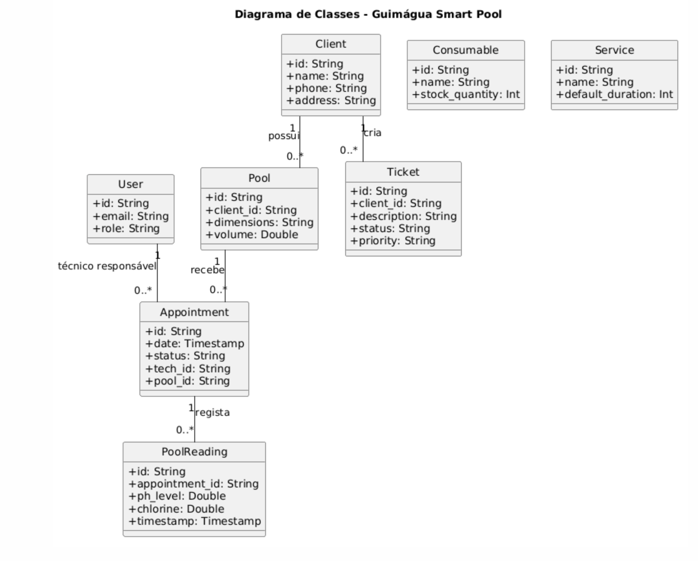

# Diagrama de Classes - Modelos de Dados (Data Classes)

| Campo | Valor |
|---|---|
| Card Trello | #112 — [abrir no Trello](https://trello.com/c/Rd1RX5nZ) |
| Lista / Sprint | 20.11.2026 Sprint 1 CM |
| Etiquetas | Documentação |
| Responsáveis | Pedro Ponteira |
| Última atividade | 2026-11-20 |

## Descrição

- Mapear a estrutura da base de dados (Firestore) para classes nativas em Kotlin (_Data Classes_), garantindo uma correspondência exata com as 8 coleções do projeto.
- **O que deve desenhar/listar (Classes e alguns atributos base):**
  - Classe `User` (Mapeia `users`) - ex: id, email, role.
  - Classe `Client` (Mapeia `clients`) - ex: id, name, phone, address.
  - Classe `Pool` (Mapeia `pools`) - ex: id, client_id, dimensions, volume.
  - Classe `Appointment` (Mapeia `appointments`) - ex: id, date, status, tech\_id, pool\_id.
  - Classe `Ticket` (Mapeia `tickets`) - ex: id, client_id, description, status, priority.
  - Classe `Consumable` (Mapeia `consumables`) - ex: id, name, stock_quantity.
  - Classe `Service` (Mapeia `services`) - ex: id, name, default_duration.
  - Classe `PoolReading` (Mapeia `pool_readings`) - ex: id, appointment\_id, ph\_level, chlorine, timestamp.

## Comentários

**Pedro Ponteira — 2026-11-19**

**Pedro Ponteira — 2026-11-19**

_(código PlantUML guardado em [diagrama-01.puml](diagrama-01.puml))_

**Leandro Castro — 2026-11-19**

‌

_(código PlantUML guardado em [diagrama-02.puml](diagrama-02.puml))_

## Anexos

![image [34f851].png](01-modelos-dados-01.png)
_01-modelos-dados-01.png — original: image [34f851].png_

_01-modelos-dados-02.png — original: image.png_
