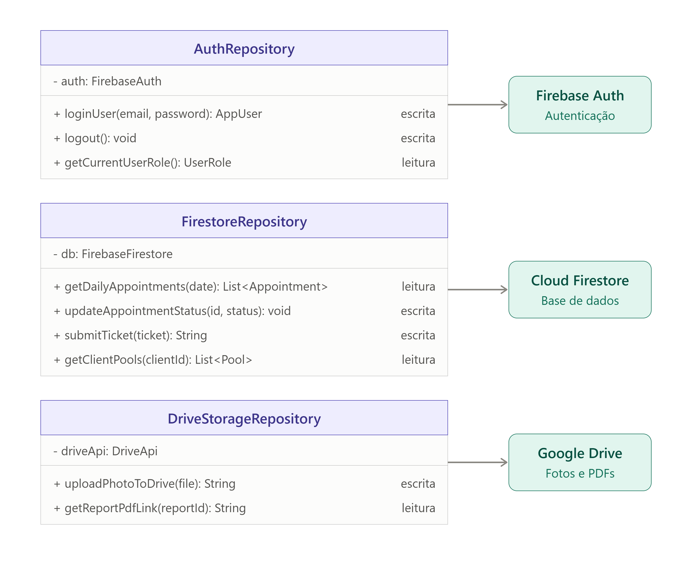
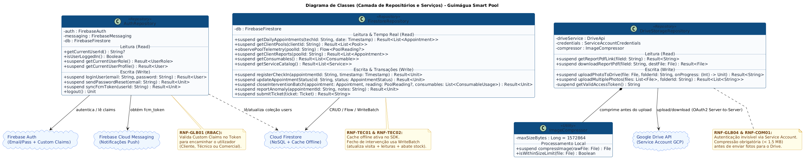

# Diagrama de Classes - Repositórios e Serviços (Backend)

| Campo | Valor |
|---|---|
| Card Trello | #113 — [abrir no Trello](https://trello.com/c/QvEXePjx) |
| Lista / Sprint | 20.11.2026 Sprint 1 CM |
| Etiquetas | Documentação |
| Responsáveis | Agustin Fernandes |
| Última atividade | 2026-11-20 |

## Descrição

- Desenhar as classes que vão comunicar com o exterior (Firebase e Google Drive), listando as funções (métodos) de leitura e escrita.
- **O que deve desenhar/listar:**
  - Classe `AuthRepository` (Funções: `loginUser()`, `logout()`, `getCurrentUserRole()`).
  - Classe `FirestoreRepository` (Funções: `getDailyAppointments()`, `updateAppointmentStatus()`, `submitTicket()`, `getClientPools()`).
  - Classe `DriveStorageRepository` (Funções: `uploadPhotoToDrive()`, `getReportPdfLink()`).

## Comentários

**Agustin Fernandes — 2026-11-19**

_(código PlantUML guardado em [diagrama-01.puml](diagrama-01.puml))_

**Leandro Castro — 2026-11-19**

_(código PlantUML guardado em [diagrama-02.puml](diagrama-02.puml))_

## Anexos

_02-repositorios-servicos-01.png — original: diagrama_classes_repositorios.png_

_02-repositorios-servicos-02.png — original: image.png_
