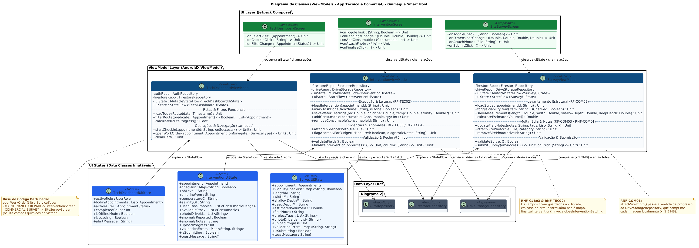

# Diagrama de Classes - ViewModels (App Técnico e Comercial)

| Campo | Valor |
|---|---|
| Card Trello | #114 — [abrir no Trello](https://trello.com/c/E1sF71PM) |
| Lista / Sprint | 20.11.2026 Sprint 1 CM |
| Etiquetas | Documentação |
| Responsáveis | Rui Filipe Rodrigues Sousa |
| Última atividade | 2026-11-20 |

## Descrição

- Desenhar a lógica de negócio dos ecrãs dos colaboradores, definindo as funções que recebem os cliques (lambdas) da interface e falam com os Repositórios.
- **O que deve desenhar/listar:**
  - Classe `TechDashboardViewModel` (Funções: `loadTodayRoute()`, `startCheckIn()`).
  - Classe `InterventionViewModel` (Funções: `saveWaterReadings()`, `markTaskDone()`, `addConsumable()`).
  - Classe `SurveyViewModel` (Comercial) (Funções: `saveMeasurements()`, `attachSitePhoto()`).

## Comentários

**Leandro Castro — 2026-11-19**

_(código PlantUML guardado em [diagrama-01.puml](diagrama-01.puml))_

## Anexos

_03-viewmodels-app-empresa.png — original: image.png_
