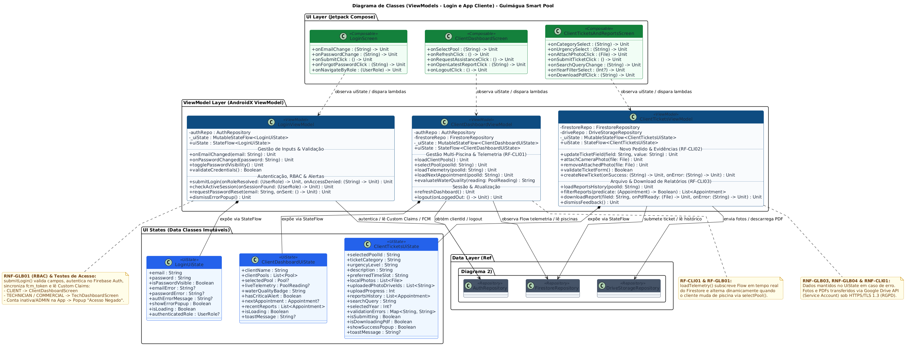

# Diagrama de Classes - ViewModels (App Cliente) e Ecrãs de Login

| Campo | Valor |
|---|---|
| Card Trello | #115 — [abrir no Trello](https://trello.com/c/6QCmtUrl) |
| Lista / Sprint | 20.11.2026 Sprint 1 CM |
| Etiquetas | Documentação |
| Responsáveis | Beatriz Ribeiro Cerqueira |
| Última atividade | 2026-11-20 |

## Descrição

- Desenhar a lógica de negócio dos ecrãs do Cliente e o fluxo inicial de entrada na aplicação.
- **O que deve desenhar/listar:**
  - Classe `LoginViewModel` (Funções: `onEmailChanged()`, `onPasswordChanged()`, `submitLogin()`, variáveis de estado para mostrar erros).
  - Classe `ClientDashboardViewModel` (Funções: `loadTelemetry()`, `loadNextAppointment()`).
  - Classe `ClientTicketsViewModel` (Funções: `createNewTicket()`, `attachCameraPhoto()`, `downloadReport()`).

## Comentários

**Leandro Castro — 2026-11-19**

_(código PlantUML guardado em [diagrama-01.puml](diagrama-01.puml))_

## Anexos

_04-viewmodels-app-cliente-login.png — original: image.png_
