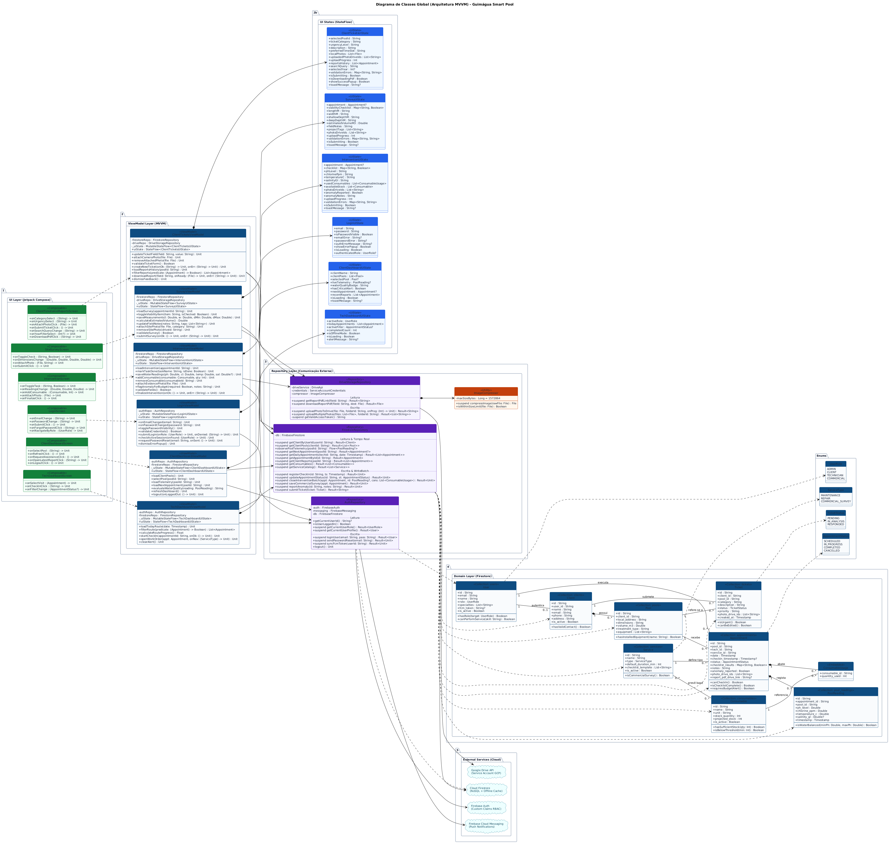

# Diagrama de Classes - Global

| Campo | Valor |
|---|---|
| Card Trello | #116 — [abrir no Trello](https://trello.com/c/ikrEdush) |
| Lista / Sprint | 20.11.2026 Sprint 1 CM |
| Etiquetas | Documentação |
| Responsáveis | — |
| Última atividade | 2026-11-20 |

## Descrição

_(sem descrição no card)_

## Anexos

- [diagrama-01.puml](diagrama-01.puml) — código PlantUML (anexo comment.txt)

_05-global.png — original: image.png_
