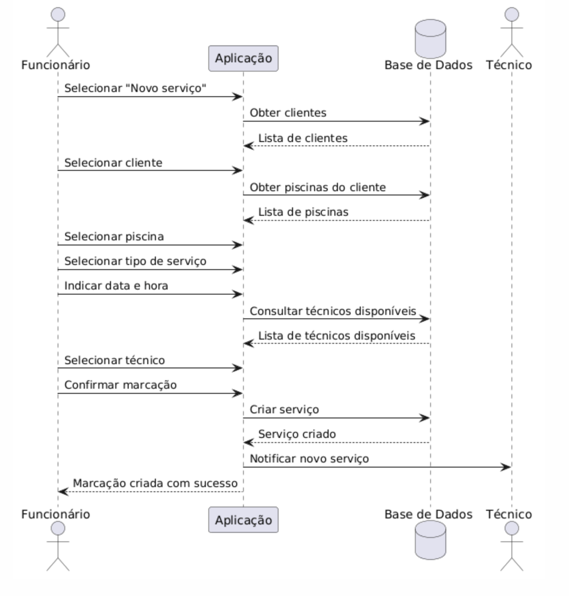
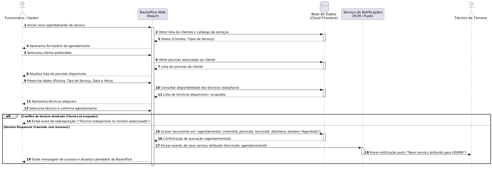

# Diagrama de Sequência: Agendamento

| Campo | Valor |
|---|---|
| Card Trello | #23 — [abrir no Trello](https://trello.com/c/bbFgNjjt) |
| Lista / Sprint | 13.10.2026 Sprint 1 WEB |
| Etiquetas | Documentação |
| Responsáveis | Pedro Ponteira, Simão Costa |
| Última atividade | 2026-11-05 |

## Descrição

Modelar o fluxo de marcação de um novo serviço, associando um técnico e um cliente.

## Anexos

_agendamento-01.png — original: Screenshot_2026-10-08_at_19.53.06.png_

_agendamento-02.png — original: image.png_
