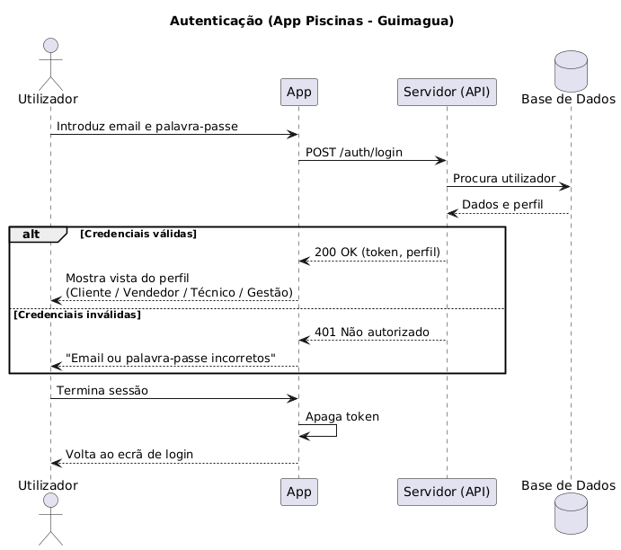
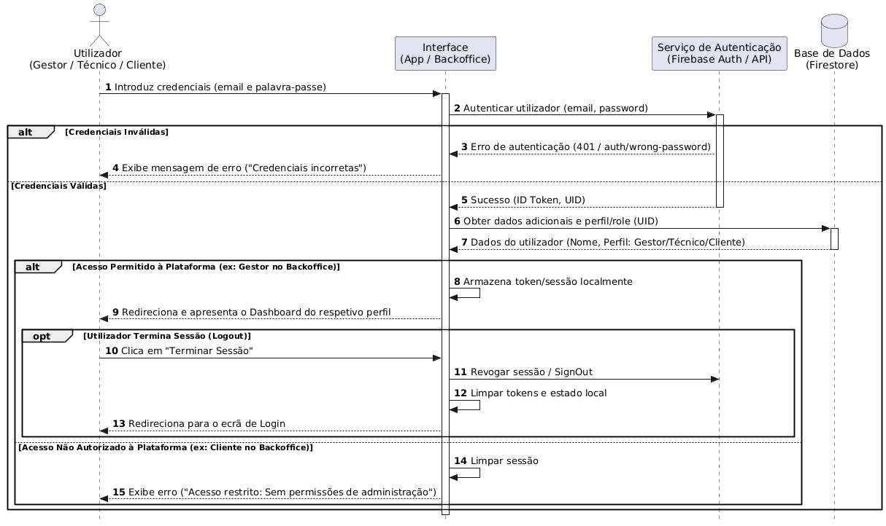

# Diagrama de Sequência: Autenticação

| Campo | Valor |
|---|---|
| Card Trello | #18 — [abrir no Trello](https://trello.com/c/V0ymOwMH) |
| Lista / Sprint | 13.10.2026 Sprint 1 WEB |
| Etiquetas | Documentação |
| Responsáveis | Alexandre Sousa, Luís Abreu |
| Última atividade | 2026-11-05 |

## Descrição

Modelar o fluxo de login do administrador no backoffice.

## Anexos

_autenticacao-01.png — original: VL9DQnin5BmBz1yUFjbGOoVqb4E97PTWGfg5s3dbyYAzke_Aqg8F7_9lIWwblsF_M9usYzCaa3tiYftHlD6CpbF6cClUQPKv.png_

_autenticacao-02.png — original: image.png_
