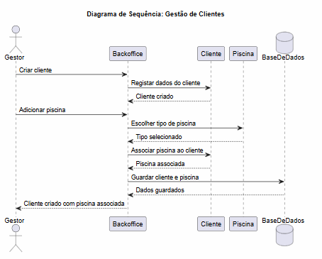
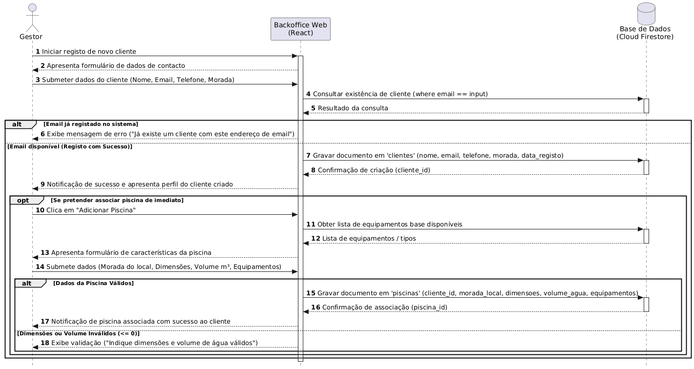

# Diagrama de Sequência: Gestão de Clientes

| Campo | Valor |
|---|---|
| Card Trello | #17 — [abrir no Trello](https://trello.com/c/P3mWu2Zz) |
| Lista / Sprint | 13.10.2026 Sprint 1 WEB |
| Etiquetas | Documentação |
| Responsáveis | André, José Gonçalo Freitas da Silva |
| Última atividade | 2026-11-05 |

## Descrição

Modelar o fluxo de criação de um cliente e associação dos respetivos tipos de piscina.

## Anexos

_gestao-clientes-01.png — original: Captura_de_ecrã_2026-10-07_140150.png_

_gestao-clientes-02.png — original: image.png_
