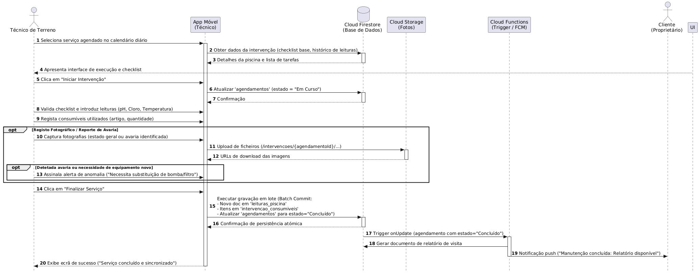

# Diagrama de Sequência: Registo de Intervenção e Leituras pelo Técnico

| Campo | Valor |
|---|---|
| Card Trello | #34 — [abrir no Trello](https://trello.com/c/cF2lR4rr) |
| Lista / Sprint | 13.10.2026 Sprint 1 WEB |
| Etiquetas | Documentação |
| Responsáveis | Leandro Castro |
| Última atividade | 2026-11-05 |

## Descrição

_(sem descrição no card)_

## Anexos

_registo-intervencao-leituras.png — original: image.png_
