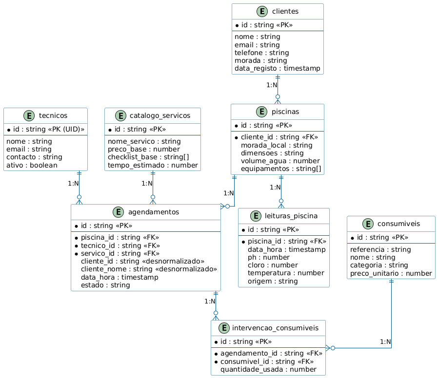

# Modelo Relacional Base de Dados

| Campo | Valor |
|---|---|
| Card Trello | #30 — [abrir no Trello](https://trello.com/c/A4FQqJ5O) |
| Lista / Sprint | 13.10.2026 Sprint 1 WEB |
| Etiquetas | Documentação |
| Responsáveis | Leandro Castro |
| Última atividade | 2026-11-05 |

## Descrição

**Coleção:** `clientes` → Regista os proprietários das piscinas.

**Campo | Tipo | Descrição**

`id` | String | Identificador único (Gerado pelo Firebase)

`nome` | String | Nome completo do client

`email` | String | Email de contacto (usado para autenticação na app móvel futura)

`telefone` | String | Número de contacto

`morada` | String | Morada principal de faturação

`data_registo` | Timestamp | Data de criação do perfil no sistema

---

**Coleção:** `piscinas` → Regista as infraestruturas associadas a cada cliente. Manter separada da coleção de clientes facilita a pesquisa agregada e a visualização no mapa ou lista global do dashboard.

**Campo | Tipo | Descrição**

`id` | String | Identificador único

`cliente_id` | String | **Referência:** ID do documento na coleção `clientes`

`morada_local` | String | Morada da piscina (caso difira da morada do cliente)

`dimensoes` | String | Ex: "8x4m"

`volume_agua` | Number | Volume em metros cúbicos

`equipamentos` | Array | Lista de strings ou objetos (ex: ["bomba", "filtro de areia", "clorador"])

---

**Coleção:** `tecnicos` → Perfis da equipa de manutenção que andará no terreno.

**Campo | Tipo | Descrição**

`id` | String | Identificador único (idealmente o `uid` do Firebase Auth)

`nome` | String | Nome do técnico

`email` | String | Email profissional (utilizado para autenticação e gestão de acessos)

`contacto` | String | Telefone profissional

`ativo` | Boolean | Controlo de acesso ao sistema

---

**Coleção:** `catalogo_servicos` -> Definição estática dos tipos de serviço prestados pela empresa.

**Campo | Tipo | Descrição**

`id` | String | Identificador único

`nome_servico` | String | Ex: "Tratamento Químico de Choque", "Limpeza Geral"

`preco_base` | Number | Custo padrão de referência em euros

`checklist_base` | Array | Lista de tarefas padrão obrigatórias (ex: ["Limpar skimmer", "Aspirar fundo", "Lavar filtro"])

`tempo_estimado` | Number | Duração média em minutos (útil para gerir a agenda)

---

**Coleção:** `consumiveis` → Catálogo de materiais, opções e preços usados nos orçamentos e serviços.

**Campo | Tipo | Descrição**

`id` | String | Identificador único

`referencia` | String | SKU ou código interno

`nome` | String | Ex: "Rede de superfície", "Cloro Rápido 5Kg"

`categoria` | String | Ex: "Químico", "Equipamento", "Acessório"

`preco_unitario` | Number | Preço em euros

---

**Coleção:** `agendamentos` **(Intervenções) ->** O núcleo operacional que cruza as diferentes entidades e gera a agenda diária. Num modelo NoSQL, é recomendável duplicar dados ligeiros (como o nome do cliente) para evitar múltiplas consultas em tempo real ao carregar o calendário.

**Campo | Tipo | Descrição**

`id` | String | Identificador único

`piscina_id` | String | **Referência:** ID da piscina a intervir

`tecnico_id` | String | **Referência:** ID do técnico atribuído

`servico_id` | String | **Referência:** ID do tipo de serviço

`cliente_id` | String | **Referência:** ID do cliente

`cliente_nome` | String | _Desnormalização:_ Evita query extra para renderizar a lista

`data_hora` | Timestamp |Momento planeado para o serviço

`estado` | String | Ex: "Agendado", "Em Curso", "Concluído", "Cancelado"

---

**Coleção:** `intervencao_consumiveis` → Associação dos materiais e produtos consumidos em cada visita, essencial para relatórios e custos.

**Campo | Tipo | Descrição**

`id` | String | Identificador único

`agendamento_id` | String | Referência: ID do documento na coleção `agendamentos`

`consumivel_id` | String | Referência: ID do produto na coleção `consumiveis`

`quantidade_usada` | Number | Quantidade efetivamente gasta durante o serviço

---

**Coleção:** `leituras_piscina` → Histórico de parâmetros físico-químicos recolhidos, base dos gráficos e alertas da aplicação.

**Campo | Tipo | Descrição**

`id` | String | Identificador único

`piscina_id` | String | Referência: ID da piscina associada

`data_hora` | Timestamp | Registo temporal da medição

`ph` | Number | Valor medido do pH (ex: 7.2)

`cloro` | Number | Valor medido do cloro livre em ppm (ex: 1.5)

`temperatura` | Number | Temperatura da água em °C

`origem` | String | Procedência dos dados (ex: "Manual\_Tecnico", "Manual\_Cliente", "Sensor_IoT")

## Anexos

_modelo-dados.png — original: image.png_
