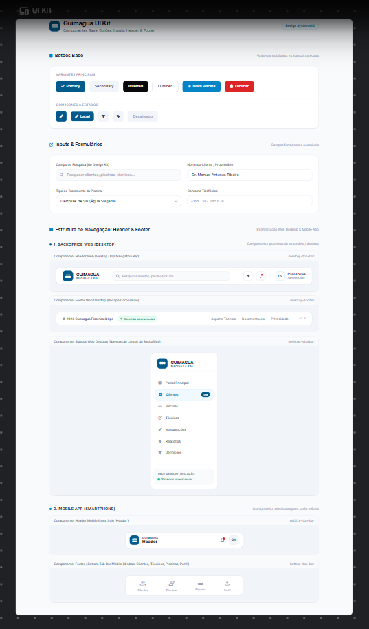
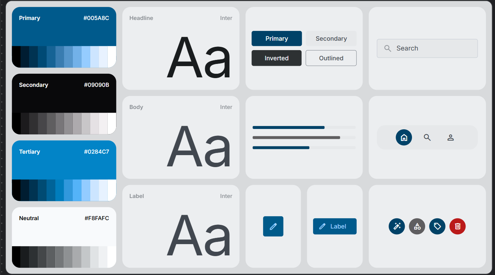

# Design System e Layout Base (Figma)

| Campo | Valor |
|---|---|
| Card Trello | #19 — [abrir no Trello](https://trello.com/c/KaBDgKP3) |
| Lista / Sprint | 13.10.2026 Sprint 1 WEB |
| Etiquetas | — |
| Responsáveis | — |
| Última atividade | 2026-10-20 |

## Descrição

Extrair cores e tipografia do site da Guimagua. Desenhar os componentes base (Botões, Inputs) e a estrutura global (Sidebar e Header do backoffice).

## Anexos

_design-system-layout-base-01.png — original: Captura_de_ecrã_2026-10-09_201519.png_

_design-system-layout-base-02.png — original: image.png_
