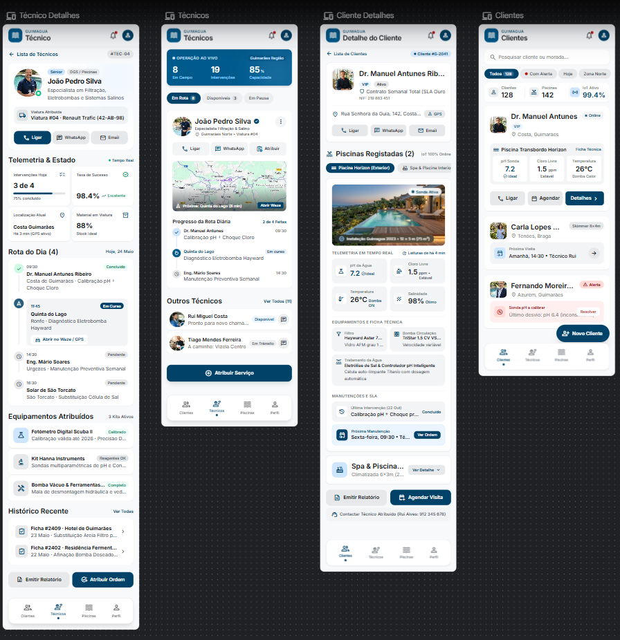

# Prototipagem: Clientes e Técnicos (Figma)

| Campo | Valor |
|---|---|
| Card Trello | #20 — [abrir no Trello](https://trello.com/c/dbZ1Lcpz) |
| Lista / Sprint | 13.10.2026 Sprint 1 WEB |
| Etiquetas | — |
| Responsáveis | Alexandre Sousa, André, Luís Abreu, José Gonçalo Freitas da Silva |
| Última atividade | 2026-10-10 |

## Descrição

Desenhar os ecrãs de listagem e de detalhe para os Clientes e para a gestão de Técnicos.

## Anexos

_clientes-e-tecnicos.png — original: Captura_de_ecrã_2026-10-09_201404.png_
