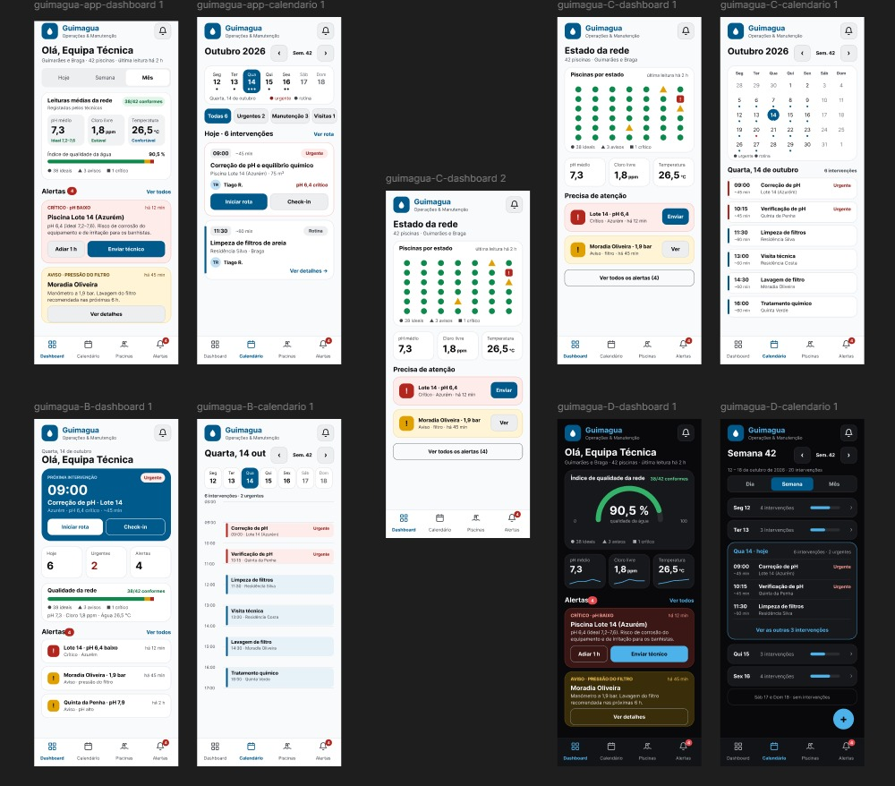

# Prototipagem: Dashboard e Calendário (Figma)

| Campo | Valor |
|---|---|
| Card Trello | #26 — [abrir no Trello](https://trello.com/c/B6OCA1BW) |
| Lista / Sprint | 13.10.2026 Sprint 1 WEB |
| Etiquetas | — |
| Responsáveis | Rodrigo Reis Rodrigues, Simão Costa, Mxthias pa |
| Última atividade | 2026-10-20 |

## Descrição

Desenhar o Dashboard inicial com métricas agregadas e a vista de calendário para a gestão visual de agendamentos.

## Anexos

- [ecras.md](ecras.md) — versão em texto de [ecras.pdf](ecras.pdf)

_dashboard-e-calendario.jpg — original: WhatsApp_Image_2026-10-09_at_18.32.51.jpeg_

## Links externos

- [Sem-título](https://www.figma.com/design/Y1G2wCfrqWllQpsdKJmcXs/Sem-t%C3%ADtulo?node-id=0-1&t=RDCsUD3WKJAbeaUn-1)
- [link do figma](https://www.figma.com/design/Y1G2wCfrqWllQpsdKJmcXs/Sem-t%C3%ADtulo?node-id=0-1&t=RDCsUD3WKJAbeaUn-1)
