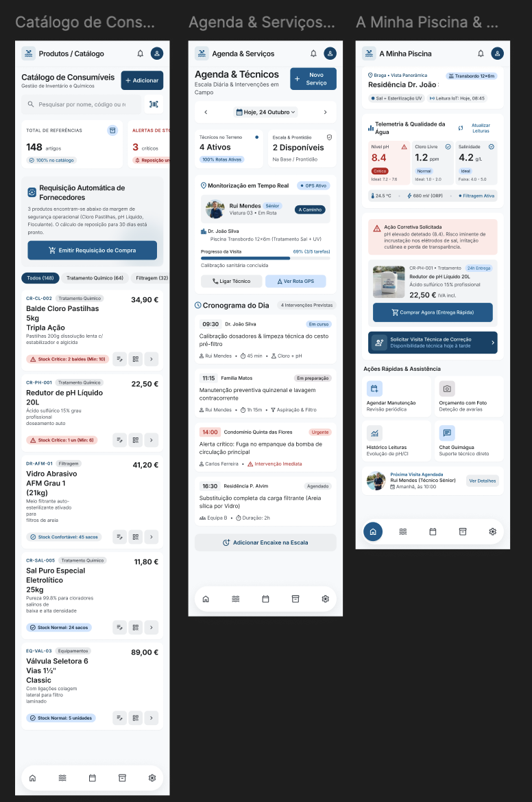

# Prototipagem: Serviços e Consumíveis (Figma)

| Campo | Valor |
|---|---|
| Card Trello | #25 — [abrir no Trello](https://trello.com/c/aGFrFmyn) |
| Lista / Sprint | 13.10.2026 Sprint 1 WEB |
| Etiquetas | — |
| Responsáveis | Pedro Ponteira, Rui Filipe Rodrigues Sousa, Nelson Silva |
| Última atividade | 2026-10-10 |

## Descrição

Desenhar as tabelas de gestão do catálogo de consumíveis/acessórios e a definição dos serviços prestados.

## Anexos

_servicos-e-consumiveis.png — original: Captura_de_ecrã_2026-10-09,_às_12.01.53.png_
