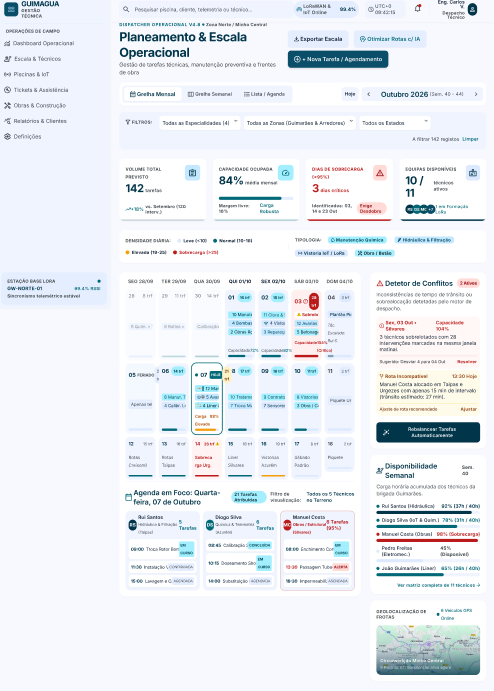

# Ecrã Calendário Geral

| Campo | Valor |
|---|---|
| Card Trello | #74 — [abrir no Trello](https://trello.com/c/udvmknqF) |
| Lista / Sprint | 17.11.2026 Sprint 4 WEB |
| Etiquetas | WEB |
| Responsáveis | Alexandre Sousa |
| Última atividade | 2026-11-17 |

## Descrição

Desenhar a vista em grelha (mensal ou semanal) com indicadores visuais do volume de tarefas previstas.

## Anexos

_calendario-geral.png — original: image.png_
