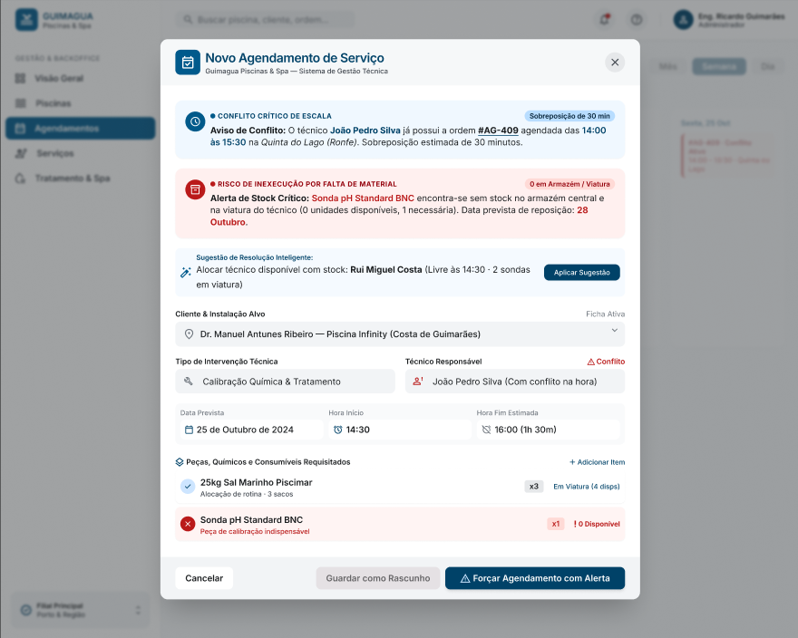

# Modal Novo Agendamento

| Campo | Valor |
|---|---|
| Card Trello | #76 — [abrir no Trello](https://trello.com/c/nsELhLG1) |
| Lista / Sprint | 27.10.2026 Sprint 3 WEB |
| Etiquetas | — |
| Responsáveis | André, Mxthias pa |
| Última atividade | 2026-11-21 |

## Descrição

Desenhar o formulário de marcação e garantir o design das duas variantes de erro: banner de sobreposição de horário e banner de rotura de stock projetado.

## Comentários

**André — 2026-10-23**

## Anexos

_modal-novo-agendamento.png — original: image.png_
