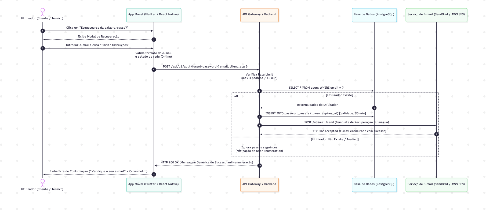
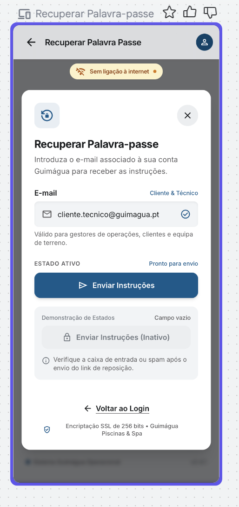
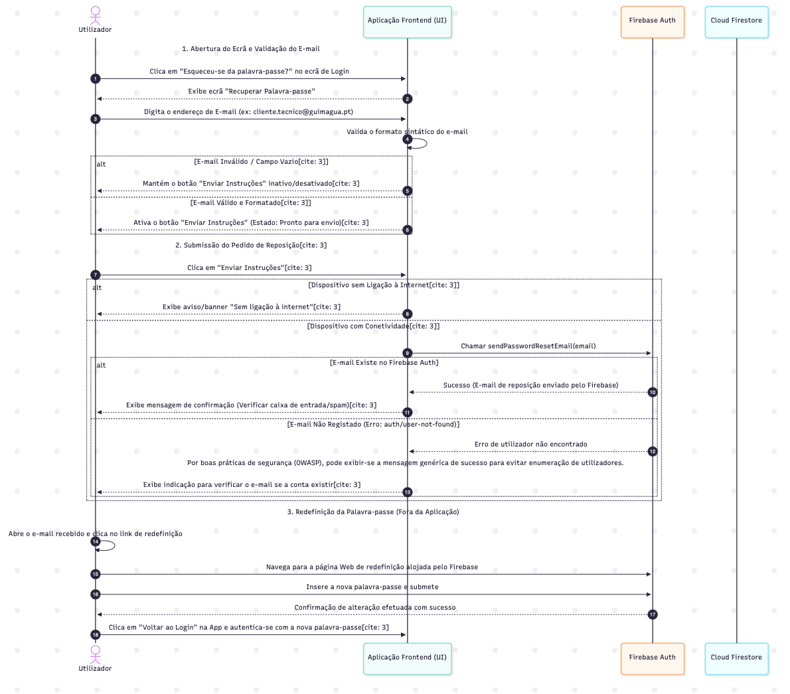
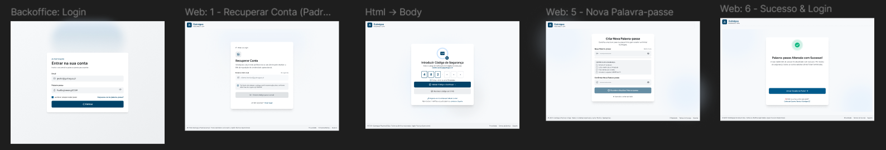

# Autenticação e Recuperação

| Campo | Valor |
|---|---|
| Card Trello | #81 — [abrir no Trello](https://trello.com/c/niBg1562) |
| Lista / Sprint | 17.11.2026 Sprint 4 WEB |
| Etiquetas | WEB |
| Responsáveis | Rui Filipe Rodrigues Sousa |
| Última atividade | 2026-11-17 |

> Existem outras versões deste ecrã/tarefa em [`outras-versoes/`](outras-versoes/):

> - [#62 — Ecrã de Autenticação (27.10.2026 Sprint 3 WEB)](outras-versoes/card-62-ecra-de-autenticacao/README.md)

## Descrição

Desenhar o fluxo de introdução de email para redefinição de acesso.

## Comentários

**Rui Filipe Rodrigues Sousa — 2026-10-26**

[Fluxo de Recuperação de Palavra Passe.docx](https://trello.com/1/cards/6ad76225bde4b42577e3ec8a/attachments/6adf760761164a9783a74c95/download/Fluxo_de_Recupera%C3%A7%C3%A3o_de_Palavra_Passe.docx "‌")

**Rui Filipe Rodrigues Sousa — 2026-10-28**


sequenceDiagram
    autonumber
    actor Utilizador
    participant Frontend as Aplicação Frontend (UI)
    participant Auth as Firebase Auth
    participant DB as Cloud Firestore

```
Note over Utilizador, Frontend: 1. Abertura do Ecrã e Validação do E-mail

Utilizador->>Frontend: Clica em "Esqueceu-se da palavra-passe?" no ecrã de Login
Frontend-->>Utilizador: Exibe ecrã "Recuperar Palavra-passe"

Utilizador->>Frontend: Digita o endereço de E-mail (ex: cliente.tecnico@guimagua.pt)
Frontend->>Frontend: Valida o formato sintático do e-mail

alt E-mail Inválido / Campo Vazio[cite: 3]
    Frontend-->>Utilizador: Mantém o botão "Enviar Instruções" inativo/desativado[cite: 3]
else E-mail Válido e Formatado[cite: 3]
    Frontend-->>Utilizador: Ativa o botão "Enviar Instruções" (Estado: Pronto para envio)[cite: 3]
end

Note over Utilizador, Frontend: 2. Submissão do Pedido de Reposição[cite: 3]

Utilizador->>Frontend: Clica em "Enviar Instruções"[cite: 3]

alt Dispositivo sem Ligação à Internet[cite: 3]
    Frontend-->>Utilizador: Exibe aviso/banner "Sem ligação à internet"[cite: 3]
else Dispositivo com Conetividade[cite: 3]
    Frontend->>Auth: Chamar sendPasswordResetEmail(email)

    alt E-mail Existe no Firebase Auth
        Auth-->>Frontend: Sucesso (E-mail de reposição enviado pelo Firebase)
        Frontend-->>Utilizador: Exibe mensagem de confirmação (Verificar caixa de entrada/spam)[cite: 3]
    else E-mail Não Registado (Erro: auth/user-not-found)
        Auth-->>Frontend: Erro de utilizador não encontrado
        Note over Frontend: Por boas práticas de segurança (OWASP), pode exibir-se a mensagem genérica de sucesso para evitar enumeração de utilizadores.
        Frontend-->>Utilizador: Exibe indicação para verificar o e-mail se a conta existir[cite: 3]
    end
end

Note over Utilizador, Auth: 3. Redefinição da Palavra-passe (Fora da Aplicação)

Utilizador->>Utilizador: Abre o e-mail recebido e clica no link de redefinição
Utilizador->>Auth: Navega para a página Web de redefinição alojada pelo Firebase
Utilizador->>Auth: Insere a nova palavra-passe e submete
Auth-->>Utilizador: Confirmação de alteração efetuada com sucesso

Utilizador->>Frontend: Clica em "Voltar ao Login" na App e autentica-se com a nova palavra-passe[cite: 3]
```

**Leandro Castro — 2026-11-05**


## Anexos

- [fluxo-de-recuperacao-de-palavra-passe.md](fluxo-de-recuperacao-de-palavra-passe.md) — versão em texto de [fluxo-de-recuperacao-de-palavra-passe.docx](fluxo-de-recuperacao-de-palavra-passe.docx)


_login-e-recuperacao-01.png — original: Captura_de_ecrã_2026-10-26,_às_15.44.06.png_


_login-e-recuperacao-02.png — original: Captura_de_ecrã_2026-10-26,_às_16.36.51.png_


_login-e-recuperacao-03.png — original: Captura_de_ecrã_2026-10-28,_às_09.19.22.png_


_login-e-recuperacao-04.png — original: Captura_de_ecrã_2026-11-05_102055.png_
