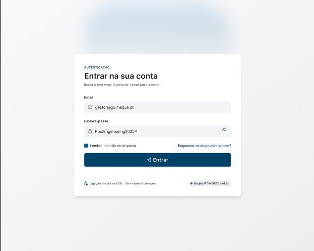

# Ecrã de Autenticação

| Campo | Valor |
|---|---|
| Card Trello | #62 — [abrir no Trello](https://trello.com/c/YJ6GkDTL) |
| Lista / Sprint | 27.10.2026 Sprint 3 WEB |
| Etiquetas | — |
| Responsáveis | André |
| Última atividade | 2026-10-24 |

## Descrição

Desenhar a página de Login e o estado/modal de recuperação de palavra-passe.

## Comentários

**André — 2026-10-23**

## Anexos

_62-ecra-de-autenticacao.png — original: image.png_
