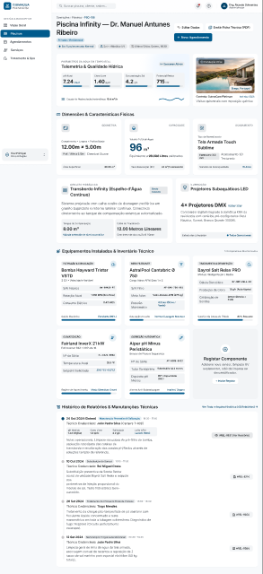

# Ecrã Detalhe da Piscina

| Campo | Valor |
|---|---|
| Card Trello | #67 — [abrir no Trello](https://trello.com/c/796TWvU3) |
| Lista / Sprint | 27.10.2026 Sprint 3 WEB |
| Etiquetas | — |
| Responsáveis | André, Mxthias pa |
| Última atividade | 2026-11-21 |

## Descrição

Desenhar a vista técnica com listagem de dimensões, equipamentos instalados e a timeline de histórico de relatórios.

## Comentários

**André — 2026-10-23**

## Anexos

_detalhe-piscina.png — original: image.png_
