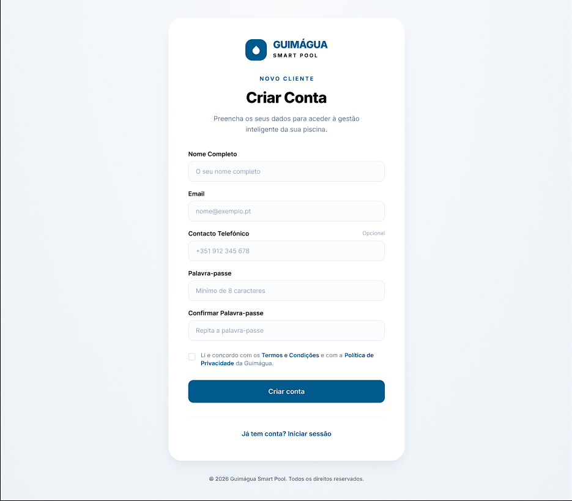

# Modal Novo Cliente

| Campo | Valor |
|---|---|
| Card Trello | #65 — [abrir no Trello](https://trello.com/c/kA3BSBLj) |
| Lista / Sprint | 17.11.2026 Sprint 4 WEB |
| Etiquetas | WEB |
| Responsáveis | Agustin Fernandes |
| Última atividade | 2026-11-17 |

## Descrição

Construir o formulário de criação de novo cliente e os respetivos estados de erro.

## Comentários

**Agustin Fernandes — 2026-10-26**

## Anexos

_modal-novo-cliente.png — original: image.png_
