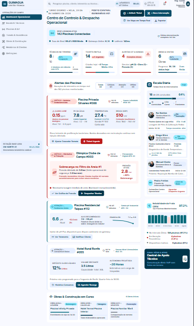

# Ecrã Dashboard

| Campo | Valor |
|---|---|
| Card Trello | #63 — [abrir no Trello](https://trello.com/c/s2apNxep) |
| Lista / Sprint | 17.11.2026 Sprint 4 WEB |
| Etiquetas | WEB |
| Responsáveis | José Gonçalo Freitas da Silva, Alexandre Sousa, Mxthias pa |
| Última atividade | 2026-11-21 |

## Descrição

Desenhar a vista central com KPIs (Técnicos no terreno, Tickets pendentes), ponto de situação da escala em tempo real e os cartões de alerta das piscinas (exceções IoT).

## Anexos

_ecra-dashboard.png — original: image.png_
