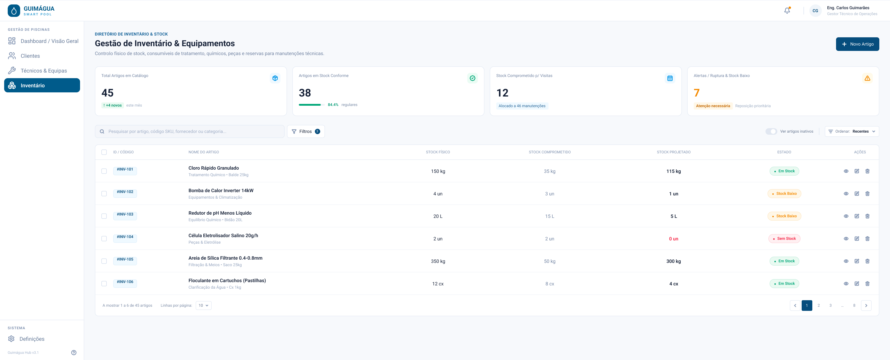

# Ecrã Lista de Inventário

| Campo | Valor |
|---|---|
| Card Trello | #72 — [abrir no Trello](https://trello.com/c/nJ3ZkTet) |
| Lista / Sprint | 17.11.2026 Sprint 4 WEB |
| Etiquetas | WEB |
| Responsáveis | Luís Abreu |
| Última atividade | 2026-11-17 |

## Descrição

Desenhar a tabela com as colunas de _Stock Físico_, _Stock Comprometido_ e _Stock Projetado_, incluindo o toggle para ver artigos inativos.

## Comentários

**Luís Abreu — 2026-11-09**

## Anexos

_lista-inventario.png — original: image.png_
