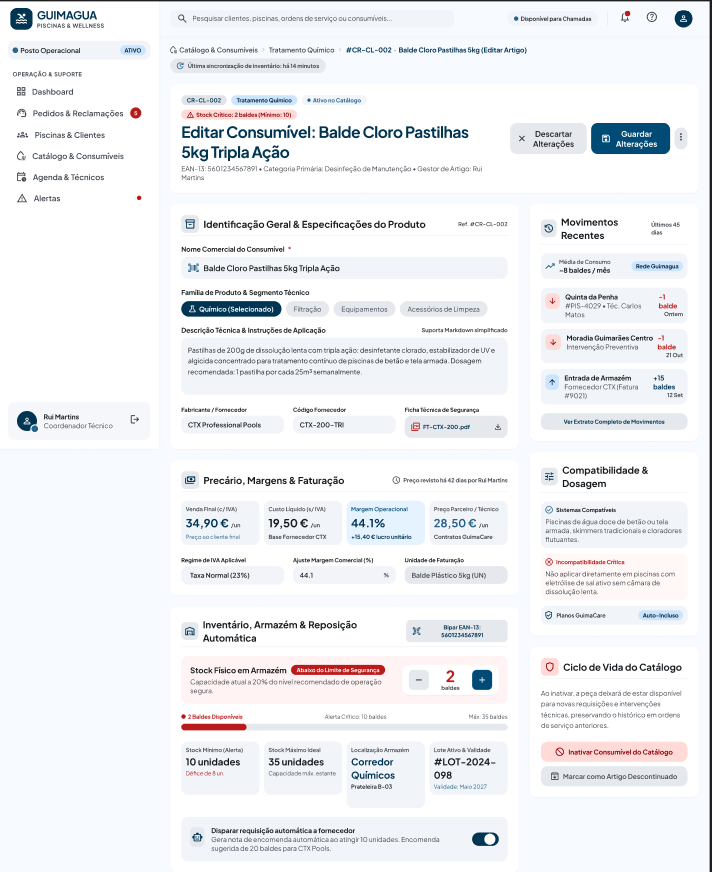

# Modal Editor de Artigo

| Campo | Valor |
|---|---|
| Card Trello | #73 — [abrir no Trello](https://trello.com/c/cvoqdQac) |
| Lista / Sprint | 17.11.2026 Sprint 4 WEB |
| Etiquetas | WEB |
| Responsáveis | José Gonçalo Freitas da Silva |
| Última atividade | 2026-11-17 |

## Descrição

Desenhar a interface para alterar a descrição, preço, quantidade de um consumível e o botão de inativação de peça.

## Anexos

_modal-editor-artigo.png — original: image.png_
