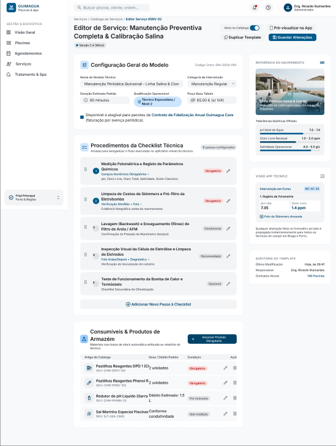

# Ecrã Editor de Serviço

| Campo | Valor |
|---|---|
| Card Trello | #71 — [abrir no Trello](https://trello.com/c/1ZZbPjRc) |
| Lista / Sprint | 27.10.2026 Sprint 3 WEB |
| Etiquetas | — |
| Responsáveis | André |
| Última atividade | 2026-10-24 |

## Descrição

Desenhar o layout de configuração, o construtor da Checklist ordenável e a área de seleção de produtos obrigatórios.

## Comentários

**André — 2026-10-23**

## Anexos

_editor-servico.png — original: image.png_
