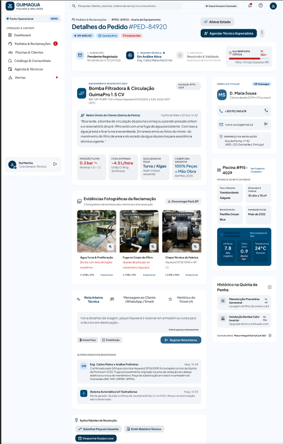

# Ecrã Detalhe do Ticket

| Campo | Valor |
|---|---|
| Card Trello | #78 — [abrir no Trello](https://trello.com/c/jIfIsK37) |
| Lista / Sprint | 17.11.2026 Sprint 4 WEB |
| Etiquetas | WEB |
| Responsáveis | José Gonçalo Freitas da Silva |
| Última atividade | 2026-11-17 |

## Descrição

Desenhar a vista de leitura do pedido, galeria de visualização das fotos anexadas pelo cliente e a alteração de estado (Pendente → Em Análise → Respondido).

## Âmbito implementado

- A vista de detalhe abre em `/tickets?ticket=<id>` e usa o ID do documento como referência.
- O progresso representa os três estados oficiais. O SLA é calculado a partir de `created_at`, com a meta definida em `src/features/tickets/utils/sla.js`.
- O detalhe mostra os campos disponíveis em `tickets`, `clients`, `pools`, `pool_readings` e `appointments`. Não apresenta indicadores, garantias, contratos ou datas de instalação que não existam no modelo.
- A resposta fica registada em `response_message`, `responded_at` e `updated_at`; o envio por email/telefone é manual.
- A consulta mostra a última leitura da piscina e a primeira página de cinco intervenções concluídas. Consultas compostas podem exigir índices `pool_id + timestamp desc` em `pool_readings`, `pool_id + status + date desc` em `appointments` e `client_id + is_active` em `pools`.
- A galeria de fotos fica pendente do chore separado que adicionará Firebase Storage a `src/config/firebase.js`. Notas internas, histórico de eventos, ZIP, relatórios e operações de inventário ficam fora deste incremento.

## Anexos

_detalhe-ticket.png — original: image.png_
