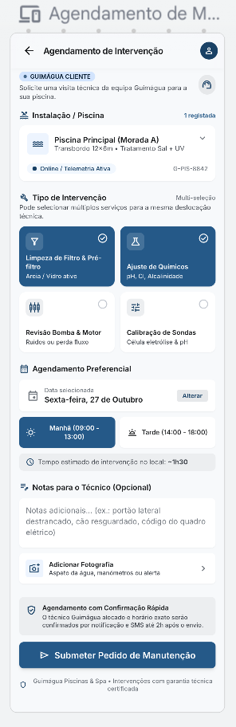
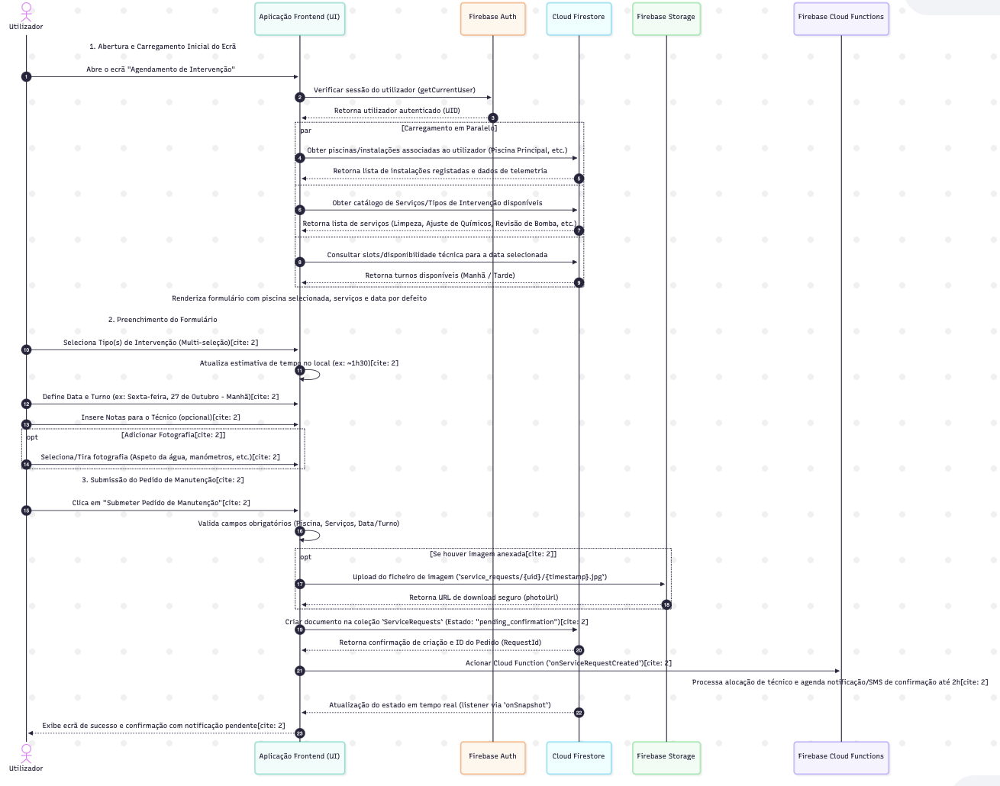

# Modal de Agendamento de Manutenção

| Campo | Valor |
|---|---|
| Card Trello | #86 — [abrir no Trello](https://trello.com/c/jKSFcyli) |
| Lista / Sprint | 17.11.2026 Sprint 4 WEB |
| Etiquetas | APP |
| Responsáveis | Rui Filipe Rodrigues Sousa |
| Última atividade | 2026-11-17 |

## Descrição

Desenhar o formulário de solicitação de serviço regular (ex: Limpeza de Filtro), permitindo ao cliente sugerir uma data/hora preferencial.

## Comentários

**Rui Filipe Rodrigues Sousa — 2026-10-26**

[Modal de Agendamento de Manutenção.docx](https://trello.com/1/cards/6ad762a05a7589d8fe404f81/attachments/6adf798ad772e0005140e442/download/Modal_de_Agendamento_de_Manuten%C3%A7%C3%A3o.docx "‌")

**Rui Filipe Rodrigues Sousa — 2026-10-26**


**Rui Filipe Rodrigues Sousa — 2026-10-28**


sequenceDiagram
    autonumber
    actor Utilizador
    participant Frontend as Aplicação Frontend (UI)
    participant Auth as Firebase Auth
    participant DB as Cloud Firestore
    participant Storage as Firebase Storage
    participant CF as Firebase Cloud Functions

```
Note over Utilizador, Frontend: 1. Abertura e Carregamento Inicial do Ecrã

Utilizador->>Frontend: Abre o ecrã "Agendamento de Intervenção"
Frontend->>Auth: Verificar sessão do utilizador (getCurrentUser)
Auth-->>Frontend: Retorna utilizador autenticado (UID)

par Carregamento em Paralelo
    Frontend->>DB: Obter piscinas/instalações associadas ao utilizador (Piscina Principal, etc.)
    DB-->>Frontend: Retorna lista de instalações registadas e dados de telemetria
and
    Frontend->>DB: Obter catálogo de Serviços/Tipos de Intervenção disponíveis
    DB-->>Frontend: Retorna lista de serviços (Limpeza, Ajuste de Químicos, Revisão de Bomba, etc.)
and
    Frontend->>DB: Consultar slots/disponibilidade técnica para a data selecionada
    DB-->>Frontend: Retorna turnos disponíveis (Manhã / Tarde)
end

Note over Frontend: Renderiza formulário com piscina selecionada, serviços e data por defeito

Note over Utilizador, Frontend: 2. Preenchimento do Formulário

Utilizador->>Frontend: Seleciona Tipo(s) de Intervenção (Multi-seleção)[cite: 2]
Frontend->>Frontend: Atualiza estimativa de tempo no local (ex: ~1h30)[cite: 2]

Utilizador->>Frontend: Define Data e Turno (ex: Sexta-feira, 27 de Outubro - Manhã)[cite: 2]
Utilizador->>Frontend: Insere Notas para o Técnico (opcional)[cite: 2]

opt Adicionar Fotografia[cite: 2]
    Utilizador->>Frontend: Seleciona/Tira fotografia (Aspeto da água, manómetros, etc.)[cite: 2]
end

Note over Utilizador, Frontend: 3. Submissão do Pedido de Manutenção[cite: 2]

Utilizador->>Frontend: Clica em "Submeter Pedido de Manutenção"[cite: 2]
Frontend->>Frontend: Valida campos obrigatórios (Piscina, Serviços, Data/Turno)

opt Se houver imagem anexada[cite: 2]
    Frontend->>Storage: Upload do ficheiro de imagem (`service_requests/{uid}/{timestamp}.jpg`)
    Storage-->>Frontend: Retorna URL de download seguro (photoUrl)
end

Frontend->>DB: Criar documento na coleção `ServiceRequests` (Estado: "pending_confirmation")[cite: 2]
DB-->>Frontend: Retorna confirmação de criação e ID do Pedido (RequestId)

Frontend->>CF: Acionar Cloud Function (`onServiceRequestCreated`)[cite: 2]
Note over CF: Processa alocação de técnico e agenda notificação/SMS de confirmação até 2h[cite: 2]

DB-->>Frontend: Atualização do estado em tempo real (listener via `onSnapshot`)
Frontend-->>Utilizador: Exibe ecrã de sucesso e confirmação com notificação pendente[cite: 2]
```

## Anexos

- [modal-de-agendamento-de-manutencao.md](modal-de-agendamento-de-manutencao.md) — versão em texto de [modal-de-agendamento-de-manutencao.docx](modal-de-agendamento-de-manutencao.docx)


_agendamento-manutencao-01.png — original: Captura_de_ecrã_2026-10-26,_às_16.41.27.png_


_agendamento-manutencao-02.png — original: Captura_de_ecrã_2026-10-28,_às_09.14.14.png_
