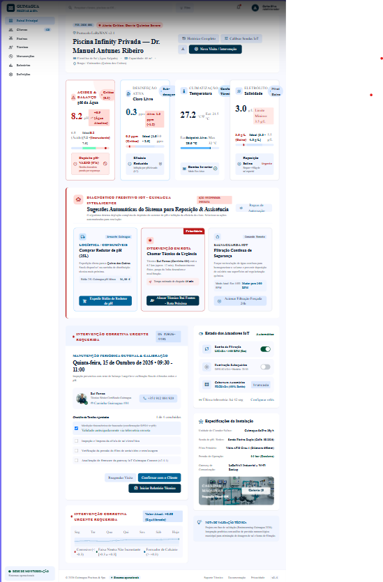

# Cliente: Ecrã de Alerta e Ação Corretiva

| Campo | Valor |
|---|---|
| Card Trello | #95 — [abrir no Trello](https://trello.com/c/sUxtyNgn) |
| Lista / Sprint | 17.11.2026 Sprint 4 WEB |
| Etiquetas | APP |
| Responsáveis | Simão Costa |
| Última atividade | 2026-11-17 |

> Existem outras versões deste ecrã/tarefa em [`outras-versoes/`](outras-versoes/):

> - [#83 — Alerta de Ação Corretiva (Upsell) (27.10.2026 Sprint 3 WEB)](outras-versoes/card-83-alerta-de-acao-corretiva-upsell/README.md)

## Descrição

Estado visual vermelho/laranja na telemetria, com um cartão de sugestão automática ("Comprar Redutor de pH" ou "Chamar Técnico").

## Anexos

_alerta-acao-corretiva.png — original: Piscina_Infinty_Privada.png_
