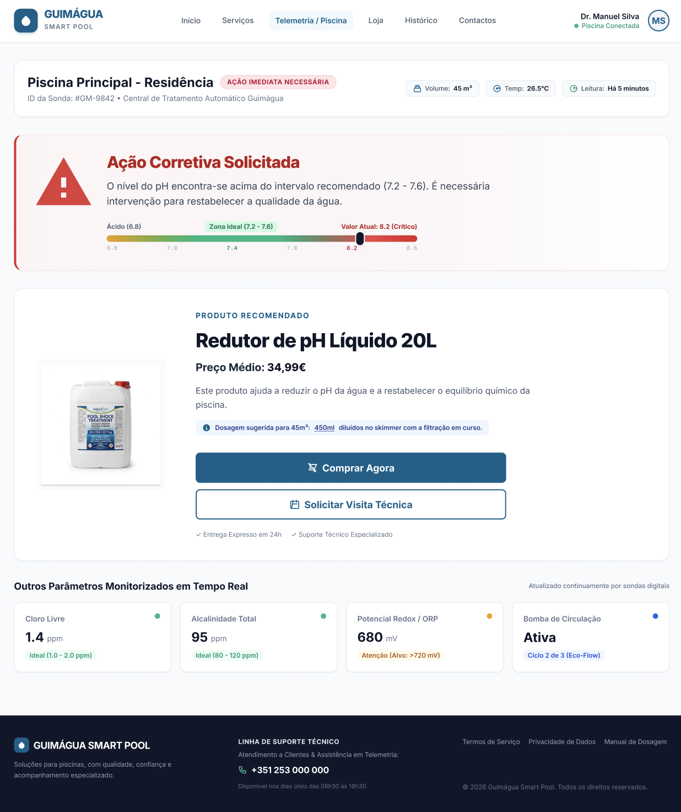

# Alerta de Ação Corretiva (Upsell)

| Campo | Valor |
|---|---|
| Card Trello | #83 — [abrir no Trello](https://trello.com/c/kPkWRNbc) |
| Lista / Sprint | 27.10.2026 Sprint 3 WEB |
| Etiquetas | — |
| Responsáveis | Pedro Ponteira |
| Última atividade | 2026-10-24 |

## Descrição

Desenhar o estado de erro/alerta na telemetria (ex: _Nível de pH Crítico_) com a sugestão direta de um produto químico e botões de ação ("Comprar Agora" ou "Solicitar Visita Técnica").

## Comentários

**Pedro Ponteira — 2026-10-21**

## Anexos

_83-alerta-de-acao-corretiva-upsell.png — original: image.png_
