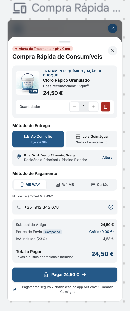
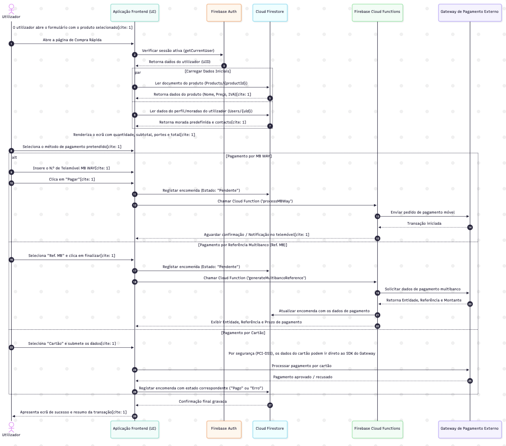

# Modal de Checkout/Compra Rápida

| Campo | Valor |
|---|---|
| Card Trello | #88 — [abrir no Trello](https://trello.com/c/tFuO2k0B) |
| Lista / Sprint | 17.11.2026 Sprint 4 WEB |
| Etiquetas | APP |
| Responsáveis | Rui Filipe Rodrigues Sousa |
| Última atividade | 2026-11-17 |

## Descrição

Desenhar um fluxo simplificado para o cliente encomendar diretamente os consumíveis sugeridos pela aplicação.

## Comentários

**Rui Filipe Rodrigues Sousa — 2026-10-26**

[Fluxo de Interação e Passos do Modal de Checkout.docx](https://trello.com/1/cards/6ad762be21daeb2dc6c72504/attachments/6adf7c5ebb12ae63f7342826/download/Fluxo_de_Intera%C3%A7%C3%A3o_e_Passos_do_Modal_de_Checkout.docx "‌")

**Rui Filipe Rodrigues Sousa — 2026-10-26**


**Rui Filipe Rodrigues Sousa — 2026-10-27**


```
sequenceDiagram
    autonumber
    actor Utilizador
    participant Frontend as Aplicação Frontend (UI)
    participant Auth as Firebase Auth
    participant DB as Cloud Firestore
    participant CF as Firebase Cloud Functions
    participant Gateway as Gateway de Pagamento Externo

    Note over Utilizador, Frontend: O utilizador abre o formulário com o produto selecionado[cite: 1]

    Utilizador->>Frontend: Abre a página de Compra Rápida
    Frontend->>Auth: Verificar sessão ativa (getCurrentUser)
    Auth-->>Frontend: Retorna dados do utilizador (UID)

    par Carregar Dados Iniciais
        Frontend->>DB: Ler documento do produto (Products/{productId})
        DB-->>Frontend: Retorna dados do produto (Nome, Preço, IVA)[cite: 1]
    and
        Frontend->>DB: Ler dados do perfil/moradas do utilizador (Users/{uid})
        DB-->>Frontend: Retorna morada predefinida e contacto[cite: 1]
    end

    Note over Frontend: Renderiza o ecrã com quantidade, subtotal, portes e total[cite: 1]

    Utilizador->>Frontend: Seleciona o método de pagamento pretendido[cite: 1]

    alt Pagamento por MB WAY
        Utilizador->>Frontend: Insere o N.º de Telemóvel MB WAY[cite: 1]
        Utilizador->>Frontend: Clica em "Pagar"[cite: 1]
        Frontend->>DB: Registar encomenda (Estado: "Pendente")
        Frontend->>CF: Chamar Cloud Function (`processMBWay`)
        CF->>Gateway: Enviar pedido de pagamento móvel
        Gateway-->>CF: Transação iniciada
        CF-->>Frontend: Aguardar confirmação / Notificação no telemóvel[cite: 1]

    else Pagamento por Referência Multibanco (Ref. MB)
        Utilizador->>Frontend: Seleciona "Ref. MB" e clica em finalizar[cite: 1]
        Frontend->>DB: Registar encomenda (Estado: "Pendente")
        Frontend->>CF: Chamar Cloud Function (`generateMultibancoReference`)
        CF->>Gateway: Solicitar dados de pagamento multibanco
        Gateway-->>CF: Retorna Entidade, Referência e Montante
        CF->>DB: Atualizar encomenda com os dados de pagamento
        CF-->>Frontend: Exibir Entidade, Referência e Prazo de pagamento

    else Pagamento por Cartão
        Utilizador->>Frontend: Seleciona "Cartão" e submete os dados[cite: 1]
        Note over Frontend, Gateway: Por segurança (PCI-DSS), os dados do cartão podem ir direto ao SDK do Gateway
        Frontend->>Gateway: Processar pagamento por cartão
        Gateway-->>Frontend: Pagamento aprovado / recusado
        Frontend->>DB: Registar encomenda com estado correspondente ("Pago" ou "Erro")
    end

    DB-->>Frontend: Confirmação final gravada
    Frontend-->>Utilizador: Apresenta ecrã de sucesso e resumo da transação[cite: 1]
```

## Anexos

- [fluxo-de-interacao-e-passos-do-modal-de-checkout.md](fluxo-de-interacao-e-passos-do-modal-de-checkout.md) — versão em texto de [fluxo-de-interacao-e-passos-do-modal-de-checkout.docx](fluxo-de-interacao-e-passos-do-modal-de-checkout.docx)


_checkout-compra-rapida-01.png — original: Captura_de_ecrã_2026-10-26,_às_16.37.55.png_


_checkout-compra-rapida-02.png — original: Captura_de_ecrã_2026-10-27,_às_12.40.13.png_
