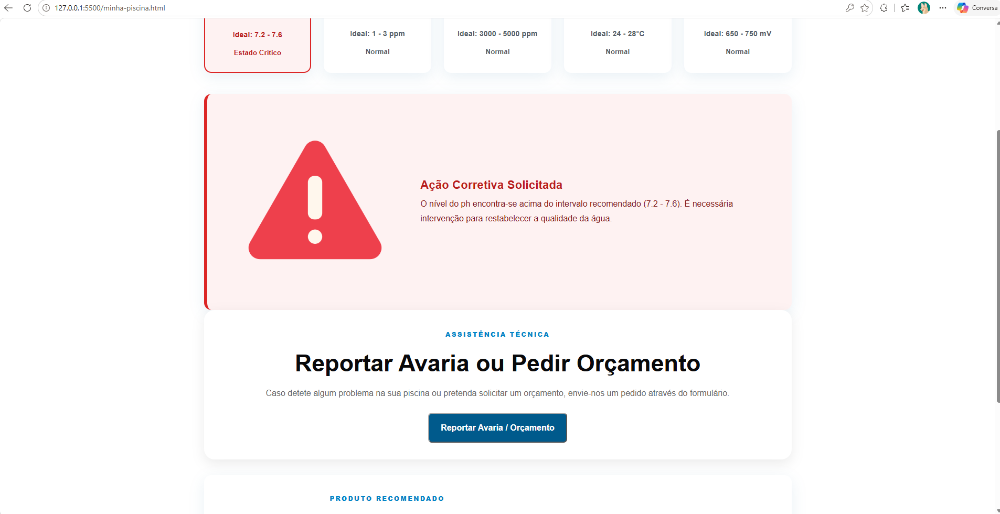
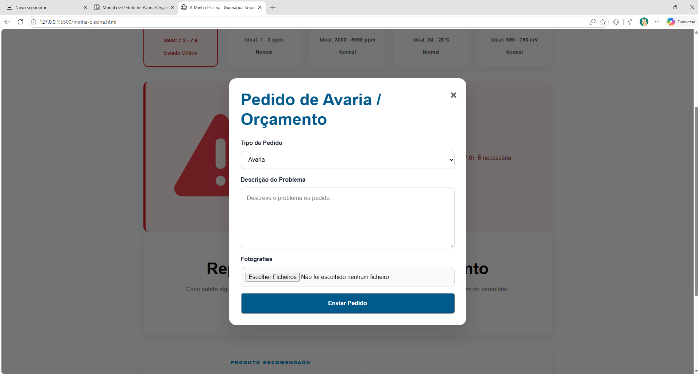

# Modal de Pedido de Avaria/Orçamento

| Campo | Valor |
|---|---|
| Card Trello | #85 — [abrir no Trello](https://trello.com/c/Ur3cCE10) |
| Lista / Sprint | 17.11.2026 Sprint 4 WEB |
| Etiquetas | APP |
| Responsáveis | Nelson Silva |
| Última atividade | 2026-11-17 |

> Existem outras versões deste ecrã/tarefa em [`outras-versoes/`](outras-versoes/):

> - [#96 — Cliente: Formulário de Assistência/Orçamento (17.11.2026 Sprint 4 WEB)](outras-versoes/card-96-cliente-formulario-de-assistencia-orcamento/README.md)

## Descrição

Construir o formulário onde o cliente reporta um problema técnico, incluindo o campo de descrição e a área de _upload_ de fotografias.

## Anexos

_pedido-avaria-orcamento-01.png — original: Captura_de_ecrã_2026-10-26_230648.png_

_pedido-avaria-orcamento-02.png — original: Captura_de_ecrã_2026-10-26_230707.png_
