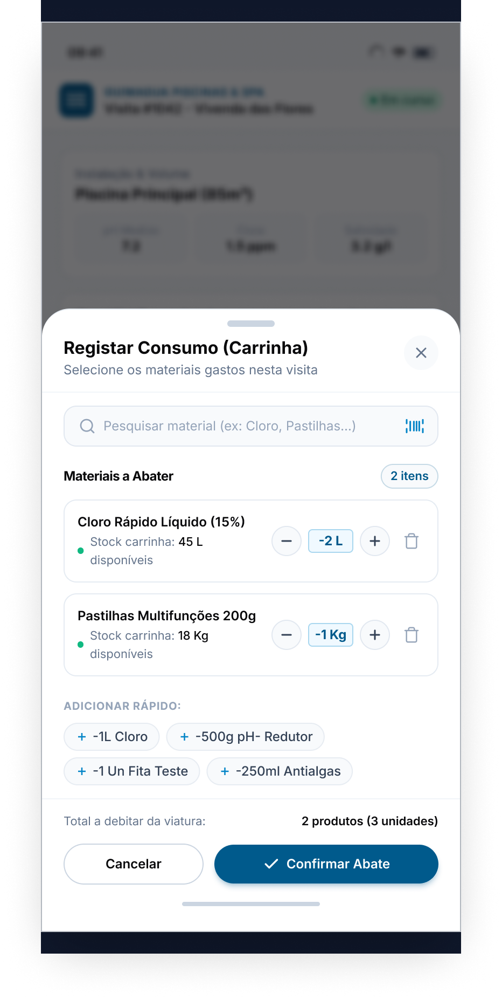

# Técnico: Registo de Consumíveis

| Campo | Valor |
|---|---|
| Card Trello | #100 — [abrir no Trello](https://trello.com/c/hRrohNcu) |
| Lista / Sprint | 17.11.2026 Sprint 4 WEB |
| Etiquetas | APP |
| Responsáveis | Luís Abreu |
| Última atividade | 2026-11-17 |

## Descrição

Ecrã ou _bottom sheet_ (modal de fundo) para o técnico pesquisar no catálogo os materiais que gastou da carrinha (ex: "-2L Cloro") para o abate automático.

## Comentários

**Luís Abreu — 2026-10-29**

## Anexos

_registo-consumiveis.png — original: image.png_
