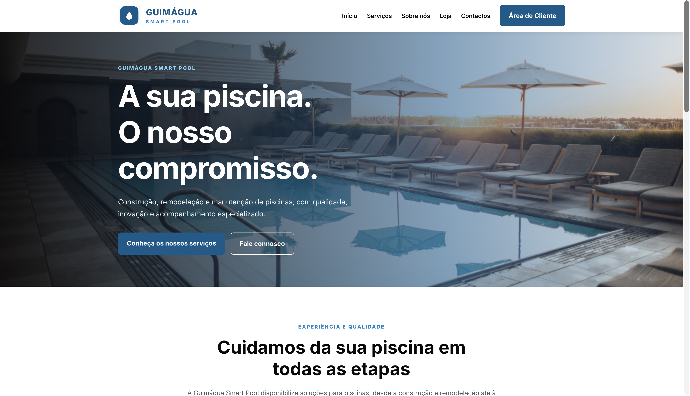

# Landing Page Institucional e Catálogo Público

| Campo | Valor |
|---|---|
| Card Trello | #46 — [abrir no Trello](https://trello.com/c/0aYacYd6) |
| Lista / Sprint | 20.10.2026 Sprint 2 WEB |
| Etiquetas | — |
| Responsáveis | Pedro Ponteira, Simão Costa |
| Última atividade | 2026-10-25 |

> Existem outras versões deste ecrã/tarefa em [`outras-versoes/`](outras-versoes/):

> - [#79 — Landing Page (Página Inicial) (27.10.2026 Sprint 3 WEB)](outras-versoes/card-79-landing-page-pagina-inicial/README.md)

## Descrição

Desenvolver a estrutura HTML5 e estilos CSS da página principal da Guimágua (inspirada no site atual), incluindo secções de serviços (construção, remodelação, manutenção) e rodapé.

- Header de navegação responsivo com botão de acesso à "Área de Cliente".
- Secção _Hero_ (destaque principal), grelha de serviços prestados e secção de contactos.

## Anexos

![image [3237b1].png](landing-page-catalogo-publico-01.png)
_landing-page-catalogo-publico-01.png — original: image [3237b1].png_

![image [3d55a6].png](landing-page-catalogo-publico-02.png)
_landing-page-catalogo-publico-02.png — original: image [3d55a6].png_

![image [558659].png](landing-page-catalogo-publico-03.png)
_landing-page-catalogo-publico-03.png — original: image [558659].png_

![image [d4e306].png](landing-page-catalogo-publico-04.png)
_landing-page-catalogo-publico-04.png — original: image [d4e306].png_

![image [d7fecb].png](landing-page-catalogo-publico-05.png)
_landing-page-catalogo-publico-05.png — original: image [d7fecb].png_

![image [ffc1d3].png](landing-page-catalogo-publico-06.png)
_landing-page-catalogo-publico-06.png — original: image [ffc1d3].png_

_landing-page-catalogo-publico-07.png — original: image.png_
