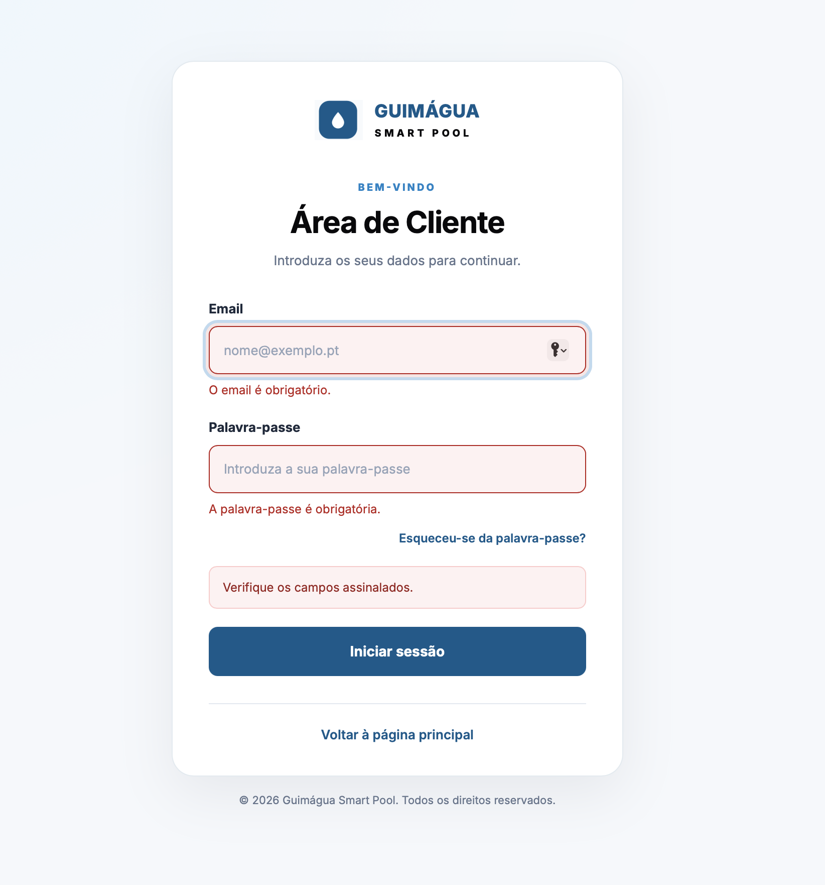

# Ecrã de Autenticação e Registo (Login)

| Campo | Valor |
|---|---|
| Card Trello | #47 — [abrir no Trello](https://trello.com/c/SBnN4LlV) |
| Lista / Sprint | 20.10.2026 Sprint 2 WEB |
| Etiquetas | — |
| Responsáveis | Pedro Ponteira, Mxthias pa |
| Última atividade | 2026-11-21 |

> Existem outras versões deste ecrã/tarefa em [`outras-versoes/`](outras-versoes/):

> - [#80 — Ecrã de Login & Registo (27.10.2026 Sprint 3 WEB)](outras-versoes/card-80-ecra-de-login-registo/README.md)

## Descrição

Maquetizar em HTML e CSS o ecrã transversal de início de sessão e recuperação de palavra-passe.

- Cartão centralizado com _inputs_ de email e palavra-passe, estados visuais de foco e estilo para mensagens de erro (ex: borda vermelha para credenciais inválidas).

## Anexos

![image [a77408].png](login-e-registo-cliente-01.png)
_login-e-registo-cliente-01.png — original: image [a77408].png_

_login-e-registo-cliente-02.png — original: image.png_
