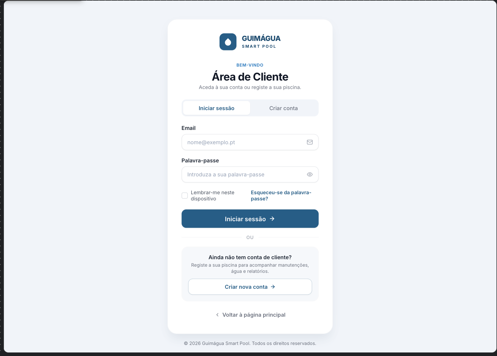

# Ecrã de Login & Registo

| Campo | Valor |
|---|---|
| Card Trello | #80 — [abrir no Trello](https://trello.com/c/xtrmKqhB) |
| Lista / Sprint | 27.10.2026 Sprint 3 WEB |
| Etiquetas | — |
| Responsáveis | Mxthias pa, Pedro Ponteira |
| Última atividade | 2026-10-24 |

## Descrição

Desenhar o formulário de entrada para clientes existentes e a opção de criar nova conta.

## Comentários

**Pedro Ponteira — 2026-10-21**

## Anexos

![image [bfb22a].png](80-ecra-de-login-registo-01.png)
_80-ecra-de-login-registo-01.png — original: image [bfb22a].png_

_80-ecra-de-login-registo-02.png — original: image.png_
