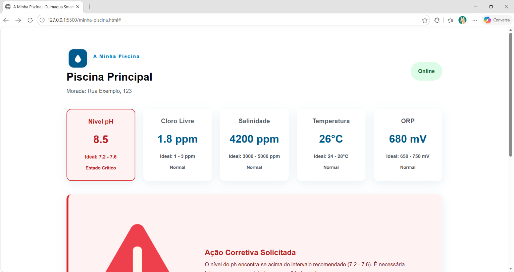
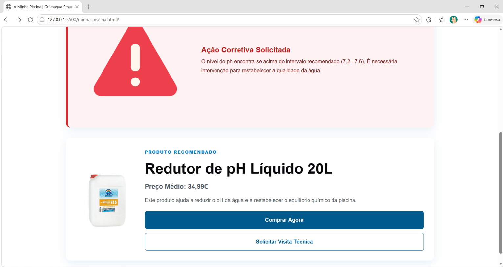

# Painel do Cliente — "A Minha Piscina" e Telemetria

| Campo | Valor |
|---|---|
| Card Trello | #48 — [abrir no Trello](https://trello.com/c/LiffRMT1) |
| Lista / Sprint | 20.10.2026 Sprint 2 WEB |
| Etiquetas | — |
| Responsáveis | Rodrigo Reis Rodrigues, Nelson Silva |
| Última atividade | 2026-10-20 |

## Descrição

Reproduzir em HTML/CSS o layout privado do cliente com base no mockup "A Minha Piscina".

- Cabeçalho com identificação da residência/piscina e estado da leitura IoT.
- Grelha de cartões de Telemetria & Qualidade da Água (Nível pH com destaque vermelho para estado crítico, Cloro Livre, Salinidade, Temperatura e ORP).
- Banner de "Ação Corretiva Solicitada" com destaque visual de alerta e cartão de sugestão direta de produto químico (ex: Redutor de pH Líquido 20L com botão "Comprar Agora" e "Solicitar Visita Técnica").

## Anexos

_painel-a-minha-piscina-01.png — original: Captura_de_ecrã_2026-10-20_004926.png_

_painel-a-minha-piscina-02.png — original: Captura_de_ecrã_2026-10-20_004945.png_
